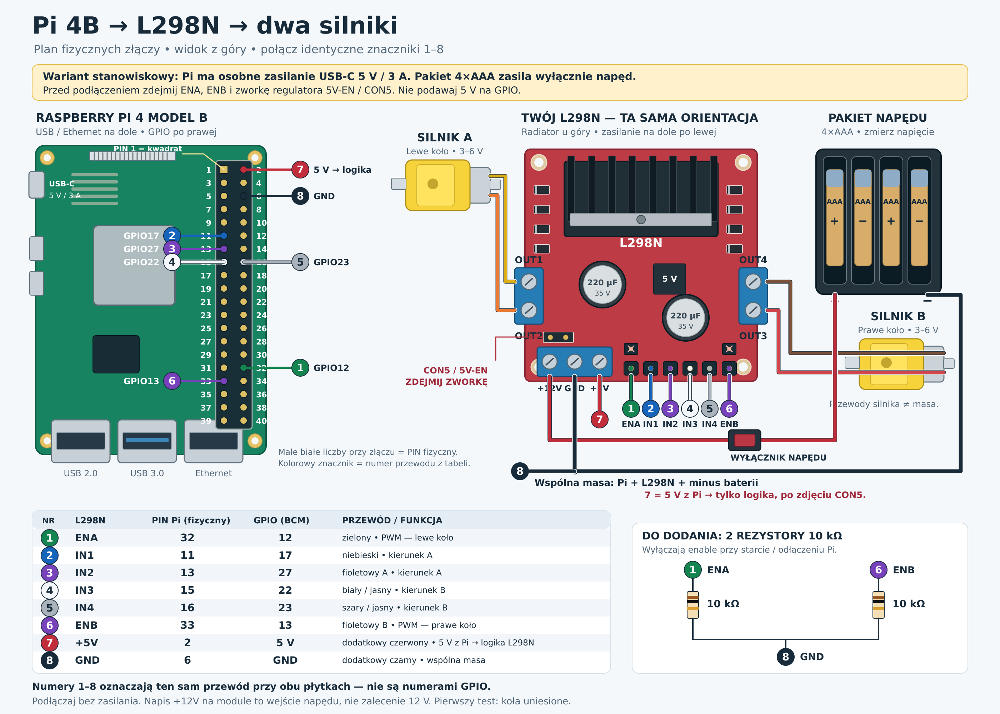

# Połączenia Pi 4B, L298N i dwóch silników

[Schemat PNG](diagrams/pi4b-l298n-polaczenia.png) · [Schemat SVG — skalowalny i edytowalny](diagrams/pi4b-l298n-polaczenia.svg)

To proponowane połączenie do pierwszego testu, oparte na zdjęciach użytkownika z 24 października 2026 i dokumentacji złączy. Nie jest potwierdzeniem wykonania ani sprawności obecnego okablowania. Na zdjęciu nie widać drugich końców przewodów sterujących. Rysunek odwzorowuje kolejność i położenie złączy; nie jest wydrukiem w skali wymiarowej 1:1.

## Jak czytać rysunek

Kolorowe znaczniki **1–8 identyfikują przewody**: ten sam numer przy obu płytkach oznacza połączenie. Nie są numerami GPIO. Małe liczby 1–40 przy złączu Pi to numery fizyczne. W programie używamy numeracji BCM z osobnej kolumny tabeli.

Pi oglądamy z góry: USB i Ethernet są na dole, złącze GPIO po prawej. Pin 1 jest na górze w rzędzie bliżej środka płytki, a pin 2 obok niego, bliżej prawej krawędzi. Dalsze pary to 3/4, 5/6, aż do 39/40.

L298N ma orientację jak na zdjęciu: radiator u góry, potrójne złącze zasilania na dole po lewej, wejścia sterowania na dole po prawej.

## Przewody między Pi i sterownikiem

| Znacznik | L298N | Pin fizyczny Pi | GPIO BCM / zasilanie | Przewód |
| --- | --- | --- | --- | --- |
| 1 | ENA | 32 | GPIO12 | Zielony, PWM silnika A |
| 2 | IN1 | 11 | GPIO17 | Niebieski |
| 3 | IN2 | 13 | GPIO27 | Fioletowy A, trzeci sygnał od lewej na L298N |
| 4 | IN3 | 15 | GPIO22 | Biały / jasny |
| 5 | IN4 | 16 | GPIO23 | Szary / jasny |
| 6 | ENB | 33 | GPIO13 | Fioletowy B, skrajny prawy sygnał na L298N |
| 7 | +5V, prawy zacisk potrójnego złącza | 2 | 5 V, pin zasilający | Dodatkowy czerwony; zasila wyłącznie logikę L298N |
| 8 | GND, środkowy zacisk potrójnego złącza | 6 | GND | Dodatkowy czarny; wspólna masa |

Kolory przewodów 1–6 są odczytane orientacyjnie ze zdjęcia. Rozstrzygające są oznaczenia na płytce i sprawdzenie, dokąd prowadzi dany przewód. Dwa fioletowe oznaczyć na obu końcach jako 3 i 6. Szczególnie łatwo pomylić **GPIO13 (pin 33)** z **pinem fizycznym 13 (GPIO27)**.

## Zasilanie i zworki

Przed zmianą połączeń odłączyć USB-C Pi i wyjąć baterie.

1. **Pi zasilać osobno przez USB-C**, stabilizowanym źródłem 5 V / 3 A. Pakietu 4×AAA nie podłączać bezpośrednio do zasilania Pi. Wersja mobilna będzie wymagała osobnego, odpowiedniego źródła dla Pi.
2. Zdjąć **zworkę regulatora 5V-EN / CON5**. Na zdjęciu jest nad potrójnym złączem zasilania, przy oznaczeniu CON5. Po jej usunięciu podać 5 V z pinu fizycznego 2 Pi na zacisk +5V modułu. Nie łączyć dwóch źródeł 5 V z założoną zworką regulatora.
3. Zworki **ENA i ENB mają być zdjęte**. Kabel PWM podłączyć do sygnałowego pinu enable na dolnym brzegu, w szeregu z IN1–IN4. Dodatkowe piny zasilania przy ENA/ENB pozostawić wolne; nie podłączać ich do GPIO.
4. Plus pakietu 4×AAA przez fizyczny wyłącznik napędu podłączyć do **lewego zacisku +12V**. Napis +12V identyfikuje wejście zasilania mostka — nie oznacza potrzeby zasilania tych silników 12 V.
5. Minus baterii oraz masę Pi, pin fizyczny 6, połączyć z **GND modułu**. W razie problemów z umieszczeniem obu przewodów w zacisku użyć odpowiedniego złącza rozdzielającego masę. Prąd silników powinien wracać do baterii przez przewód moduł–bateria, a nie przez Pi.
6. Dodać **dwa zewnętrzne rezystory 10 kΩ**: ENA–GND i ENB–GND, aby enable miały stan niski przy starcie/odłączonym Pi. Nie zwierać enable bezpośrednio do masy.

Zdjęcie przedstawia pusty koszyk; rodzaj ogniw i napięcie nie są potwierdzone. Cztery ogniwa 1,5 V dają nominalnie 6 V, a cztery akumulatory NiMH 1,2 V — 4,8 V. Napięcie pakietu należy zmierzyć także podczas rozruchu. Podane przez sklep minimum zasilania modułu to 5 V; 4,8 V jest poniżej tego zakresu. Straty L298N i spadki napięcia AAA mogą uniemożliwić rozruch lub ograniczyć moment. Sam schemat nie potwierdza wydajności tego źródła pod obciążeniem.

## Silniki

| Złącze na zdjęciu | Połączenie |
| --- | --- |
| Lewy górny OUT1 | Żółty przewód silnika A |
| Lewy dolny OUT2 | Pomarańczowy przewód silnika A |
| Prawy górny OUT4 | Brązowy przewód silnika B |
| Prawy dolny OUT3 | Czerwony przewód silnika B |

Użycie A jako lewego i B jako prawego koła jest umowne. Jeśli koło kręci się przeciwnie, kierunek odwrócić w konfiguracji agenta. Oba przewody każdego silnika trafiają na jego parę wyjść mostka; żaden nie jest na stałe masą. Pierwsze uruchomienie z uniesionymi kołami, krótką próbą i dostępnym wyłącznikiem napędu. Przy braku rozruchu wyłączyć PWM i sprawdzić zasilanie oraz połączenia.

## Źródła i pliki

- [Raspberry Pi — oficjalne położenie pinów i numeracja GPIO](https://www.raspberrypi.com/documentation/computers/raspberry-pi.html#gpio).
- [Raspberry Pi 4B — wymagania zasilania, sekcja 4.1](https://datasheets.raspberrypi.com/rpi4/raspberry-pi-4-datasheet.pdf).
- [Botland — L298N: wyprowadzenia, regulator i zworki](https://botland.com.pl/sterowniki-silnikow-moduly/3164-l298n-dwukanalowy-sterownik-silnikow-modul-12v-2a-5904422359317.html).
- [Mapa połączeń JSON](diagrams/pi4b-l298n-connections.json) jest źródłem danych pinów dla finalnego rysunku. SVG i PNG narysowano programowo z jawną numeracją kontaktów; nie są wynikiem testu sprzętu.
- Wstępna próba z użyciem wbudowanego narzędzia `imagegen` miała błędne trasy przewodów i została odrzucona. [Zapis promptu tej próby](diagrams/pi4b-l298n-prompt.txt) pozostaje jako dokumentacja; nie należy używać pierwotnej grafiki jako instrukcji. Finalne pliki do podłączania to SVG i PNG podlinkowane na początku tego dokumentu.
